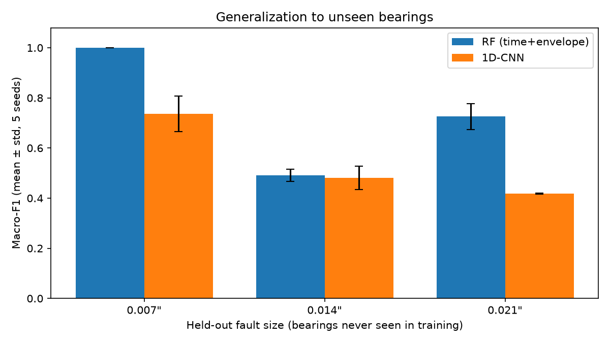
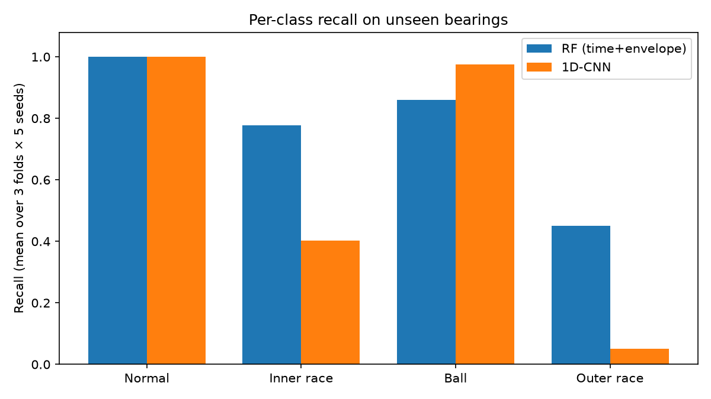

## Session 0 – 2026-11-12
- Env: macOS, Apple M2 (8 GB), VS Code, Python 3.12 via uv (system 3.14 untouched)
- Fixed ~/.local ownership (root → user), installed uv and gh (GitHub CLI auth)
- Installed numpy, scipy, pandas, matplotlib, scikit-learn, torch 2.15 (MPS available), ipykernel
- Repo skeleton: data/ (gitignored), notebooks/, src/, tests/
- First notebook: plotted a 500 Hz sine (fs = 12 kHz) → frequency = cycles per second
- Pushed to GitHub
- Next: Step 1 – download CWRU dataset, load .mat files, plot raw signals per class
## Session 1 – 2026-11-12
- Downloaded 4 CWRU files (12k DE, 0.007", 0 hp): 97 Normal, 105 IR, 118 Ball, 130 OR@6
- Loaded .mat with scipy.io.loadmat → dict; signal key: X<num>_DE_time
- 97.mat: 243,938 samples ≈ 20 s at 12 kHz
- Plotted first 0.2 s per class:
  - Normal: calm, low amplitude
  - IR / OR: periodic impulses (OR ≈ every 9 ms ≈ 107 Hz)
  - Ball: hard to distinguish from Normal by eye → expect the model to struggle here
- Next: Step 2 – windowing + leakage-free train/test split
## Session 2 – 2026-11-15
- Wrote make_windows(signal, window_size, step) using slicing
- Window = 2048 samples (~0.17 s, ~5 shaft rotations), step = 2048 (no overlap)
- Leakage-free split: split each recording by time FIRST (80% train / 20% test), THEN window
  - Why: windowing + random shuffle puts near-identical/overlapping windows in both sets → inflated scores
  - Limitation: train/test still come from the same recording → later test on unseen motor load
- Result: X_train (236, 2048), X_test (56, 2048), labels 0=Normal 1=IR 2=Ball 3=OR
- Class imbalance: train [95 47 47 47] → Normal recording is 2x longer (explains bigger 97.mat)
  → don't rely on accuracy alone; use confusion matrix / per-class metrics
- Next: Step 3 – hand-crafted features (RMS, kurtosis, FFT) + Random Forest baseline
## Session 3 – 2026-11-15
- Features: RMS, kurtosis, peak, crest factor → classes separate perfectly on 0.007"/0 hp
- RF results:
  - same-recording split: 100% | cross-load (train 0 hp, test 1-3 hp): 100%
  - BUT CWRU reuses the same physical bearing across loads → cross-load split still leaks
    (Hendriks et al. 2022, Rosa et al. 2024)
  - fault-size split (train 0.007"+0.021", test 0.014"): acc 0.44, macro-F1 0.35
    → time features measure vibration strength (depends on fault size), not fault type
- Added src/bearing_fault_detection/cwru.py: file catalog + downloader with retries (40 files)
- FFT: faults excite a ~2.5–3.7 kHz resonance (the "bell"), fault type is in the impact rhythm
- Envelope analysis: clear peaks at theoretical BPFI (~162 Hz) and BPFO (~107 Hz); Ball unclear
- Envelope features (normalized by spectrum median, rpm-aware) + time features: acc 0.53, macro-F1 0.49
  - IR recall: 0 → 131/236
  - OR 0.014" predicted as Normal: its envelope spectrum has no BPFO peak
    → consistent with Smith & Randall (2015): records 198-200 not/only partly diagnosable
- Next: Step 4 – 1D-CNN in PyTorch on raw windows, same fault-size split
## Session 4 – 2026-11-15
- Convolution = sliding a learnable filter over the signal (toy demo: [-1, 2, -1] click detector)
- Data: per-window z-normalization → removes absolute amplitude (which depends on fault size),
  forces the model to use shape/rhythm. Tensors shaped (N, 1, 2048)
- Model: BearingCNN, 4 Conv1d blocks (wide first kernel 64, stride 8) + global avg pool + linear, 21,780 params (~85 KB)
- Training: Adam lr=1e-3, CrossEntropy, 15 epochs fixed in advance (not tuned on test);
  val = random 20% of train (same bearings → optimistic, only a sanity check)
- Train/val acc 100% from epoch 2
- Test (unseen 0.014" bearings): macro-F1 0.502 vs RF time+envelope 0.485
  - Ball: 236/236 (first time), Outer race: 0/236 (no BPFO signature in data), IR often → Outer
  - Single run → difference is NOT significant yet
- Saved weights: models/cnn.pt (state_dict, gitignored)
- Next: Step 5 – 5 seeds per model (mean ± std), leave-one-fault-size-out (3 folds), plots for README
## Session 5 – 2026-11-15
- Leave-one-fault-size-out CV: 3 folds (0.007/0.014/0.021 held out) x 5 seeds x 2 models = 30 runs
- Macro-F1 (mean): RF time+envelope 0.739, 1D-CNN 0.545
  - 0.007: RF 1.000±0.000 vs CNN 0.736±0.072
  - 0.014: RF 0.492±0.025 vs CNN 0.481±0.046   ← the only fold I had looked at before
  - 0.021: RF 0.726±0.052 vs CNN 0.418±0.002   (CNN fails the same way every seed)
- Per-class recall: CNN dumps uncertain windows into "Ball" (high Ball recall, low precision)
- Lesson: single split → wrong conclusion ("CNN ≈ RF"); with little data (2 bearings/class),
  physics-based features generalize better than a small CNN
- Saved: results/fault_size_cv.csv, figures/macro_f1_by_fold.png, figures/recall_per_class.png
- Drafted README "Results" section (key findings + limitations)
- Next: Step 6 – export CNN to ONNX, measure CPU inference time
## Results

**Protocol.** Leave-one-fault-size-out cross-validation (0.007" / 0.014" / 0.021"):
the test fold contains only physical bearings never seen in training. Each model is
trained with 5 random seeds; we report mean ± std. Metric: macro-F1 (classes weighted equally).

| Held-out fault size | RF (time + envelope features) | 1D-CNN (raw signal) |
|---|---|---|
| 0.007" | **1.000 ± 0.000** | 0.736 ± 0.072 |
| 0.014" | 0.492 ± 0.025 | 0.481 ± 0.046 |
| 0.021" | **0.726 ± 0.052** | 0.418 ± 0.002 |
| **Mean** | **0.739** | 0.545 |

**Key findings**
- **Naive splits are misleading.** Random window splits and cross-load splits both give
  100% accuracy, because CWRU reuses the same physical bearing across recordings and loads.
- **Domain knowledge wins with little data.** With only two training bearings per fault type,
  physics-based envelope features (energy at the theoretical BPFI / BSF / BPFO frequencies)
  generalize better than a small CNN learning from raw signals.
- **A single test split would have misled me.** On the 0.014" fold alone, CNN and RF looked equal.
- **Some failures are data problems.** The 0.014" outer-race recordings show no BPFO peak in
  the envelope spectrum, consistent with Smith & Randall (2015), who could not diagnose them either.

**Limitations**
- CWRU has only one healthy bearing, so the Normal class always shares a bearing between
  train and test (its 100% recall is optimistic).
- Small dataset: 2 training bearings per fault type per fold.
- Laboratory test rig with artificially seeded faults; real-world performance is untested.