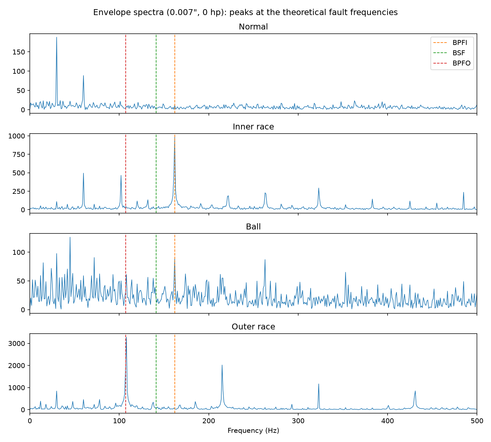
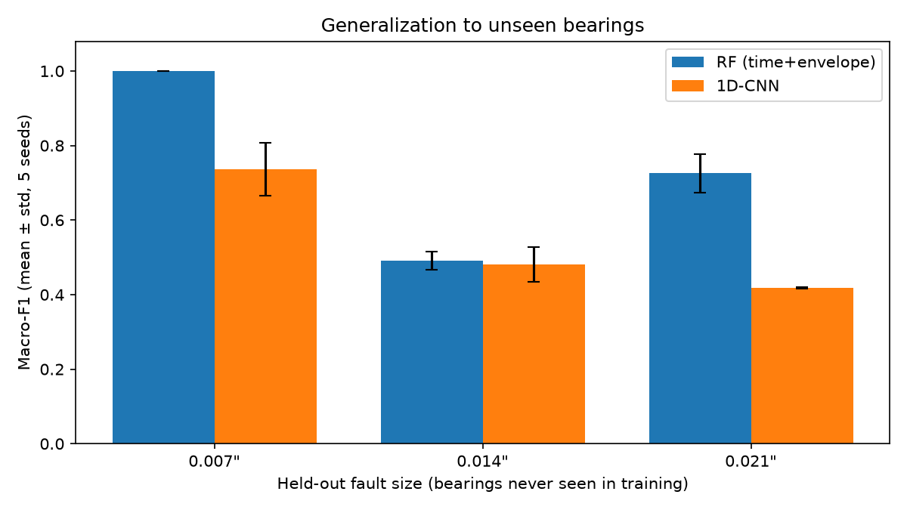
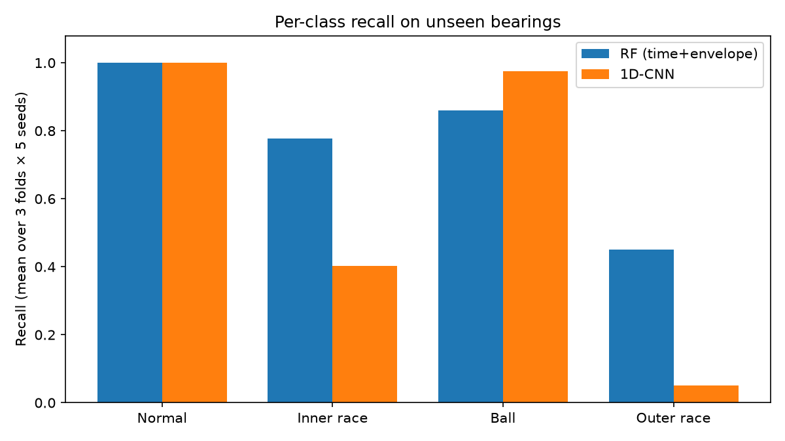

# Bearing Fault Detection on CWRU Vibration Data

[](https://github.com/Batubttl/Bearing-fault-detection/actions/workflows/ci.yml)

Classifying rolling-bearing faults (normal / inner race / ball / outer race) from accelerometer
signals, with a focus on **leakage-free evaluation**. Compares a physics-informed Random Forest
with a 1D-CNN (PyTorch), exports the CNN to **ONNX** and serves it with **FastAPI** in Docker.

**TL;DR**
- Common CWRU splits give **100% accuracy**, but they leak: the same physical bearing ends up in train and test.
- On **bearings never seen in training** (leave-one-fault-size-out CV, 5 seeds), macro-F1 drops to
  **0.74 (Random Forest + envelope features)** and **0.55 (1D-CNN)**.
- With only two training bearings per fault type, **domain knowledge (envelope analysis) beat deep learning**.
- The deployed CNN is a **107 KB ONNX** file; inference takes **~0.05 ms per window** on an Apple M2 (single thread).

---

## Problem

Bearing damage is a leading cause of failures in rotating machines. A damaged spot produces a short
impact every time a ball rolls over it. These impacts repeat at a characteristic frequency that
depends on **where** the damage is (inner race, outer race, ball). Detecting this early enables
**predictive maintenance**: repairs can be planned before the machine breaks down.

## Data

[CWRU Bearing Data Center](https://engineering.case.edu/bearingdatacenter), 12 kHz drive-end accelerometer, SKF 6205 bearing.

| Class | Recordings |
|---|---|
| Normal | 4 (loads 0–3 hp) |
| Inner race / Ball / Outer race (@6:00) | 12 each (fault sizes 0.007", 0.014", 0.021" × loads 0–3 hp) |

40 recordings in total, cut into non-overlapping windows of **2048 samples (≈ 0.17 s)**.

```bash
uv run python -m bearing_fault_detection.cwru   # downloads all 40 files to data/raw/
```

## Evaluation: why 100% is not the answer

| Split | Leakage? | RF accuracy |
|---|---|---|
| Random windows / time split of one recording | yes: same recording in train and test | 1.00 |
| Train 0 hp → test 1–3 hp | yes: CWRU reuses the **same physical bearing** across loads | 1.00 |
| **Train on two fault sizes → test on the third** | **no** (except Normal, see limitations) | **0.44** (time features only) |

The last protocol is used for all results below (as proposed by Hendriks et al., 2022).

## Approach

1. **Time features:** RMS, kurtosis, peak, crest factor.
2. **Envelope analysis:** demodulate the signal (Hilbert envelope) and measure the spectral peaks at
   the theoretical fault frequencies BPFI / BSF / BPFO (and 2nd harmonics), computed from the bearing
   geometry and the shaft speed, normalized so they do not depend on vibration amplitude.
3. **Random Forest** on time + envelope features.
4. **1D-CNN** (PyTorch, 21,780 parameters) on raw, per-window normalized signals.
   Wide first kernel (64 samples), 4 conv blocks, global average pooling.



Inner and outer race faults show clear peaks exactly at the theoretical BPFI (~162 Hz) and BPFO (~107 Hz).
Ball faults are much less clear.

## Results

Leave-one-fault-size-out cross-validation: the test fold contains only physical bearings never seen
in training. Each model is trained with 5 seeds; mean ± std of macro-F1.

| Held-out fault size | RF (time + envelope) | 1D-CNN (raw signal) |
|---|---|---|
| 0.007" | **1.000 ± 0.000** | 0.736 ± 0.072 |
| 0.014" | 0.492 ± 0.025 | 0.481 ± 0.046 |
| 0.021" | **0.726 ± 0.052** | 0.418 ± 0.002 |
| **Mean** | **0.739** | 0.545 |




**Key findings**
- **Domain knowledge wins with little data.** With only two training bearings per fault type, physics-based
  envelope features generalize better than a small CNN learning from raw signals.
- **A single test split would have misled me.** On the 0.014" fold alone, CNN and RF looked equal.
- **Some failures are data problems.** The 0.014" outer-race recordings show no BPFO peak in the envelope
  spectrum, consistent with Smith & Randall (2015), who could not diagnose them either.
- **The CNN is overconfident and collapses to "Ball"** when unsure: high ball recall, low ball precision.

## Deployment

| | |
|---|---|
| Model file | `models/cnn.onnx`, 107 KB, weights embedded |
| Correctness | ONNX vs PyTorch outputs: max abs diff 1.9e-6, identical predictions |
| Latency (1 window, Apple M2, 1 thread) | ONNX Runtime **0.054 ms** median (p95 0.063 ms), PyTorch 0.136 ms |
| Real-time budget | one window = 170.7 ms of signal |

Latency on a Raspberry Pi has **not been measured yet** (planned).

> **Note:** the API serves the CNN, although the Random Forest scored higher. The CNN runs end-to-end on raw
> signals with a single ONNX file, which made it the simpler deployment target for this project.
> Serving the RF pipeline is listed under next steps.

### API

```bash
# local
uv run uvicorn bearing_fault_detection.api:app
# or Docker (runtime image without PyTorch)
docker build -t bearing-api . && docker run --rm -p 8000:8000 bearing-api
```

```bash
curl -X POST http://127.0.0.1:8000/predict \
  -H "Content-Type: application/json" -d @samples/inner_race.json
```
```json
{"class_id": 1, "label": "Inner race",
 "probabilities": {"Normal": 0.0001, "Inner race": 0.9994, "Ball": 0.0, "Outer race": 0.0004}}
```

- Input: exactly 2048 finite numbers (Pydantic), otherwise **422**; bodies > 256 KB → **413**.
- Validation errors never echo the input (a NaN in the error body previously caused a 500; found by a test).
- Interactive docs at